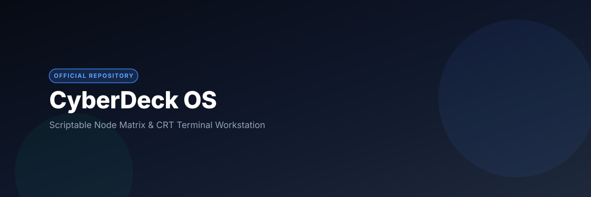
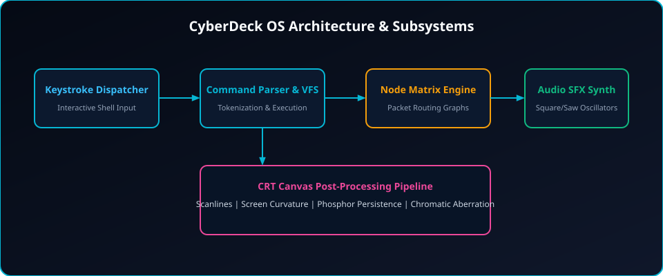
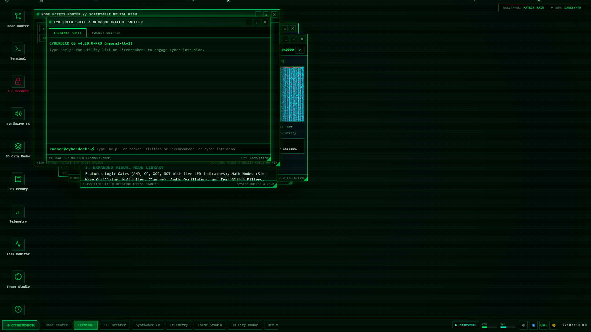

# CyberDeck OS

> Scriptable Node Matrix & CRT Terminal Workstation

   



## 📌 Executive Overview
A retro-futuristic virtual terminal and node routing matrix operating in high-performance HTML5 Canvas with custom CRT post-processing, scriptable command parser, and Web Audio sound synthesizer.

---

## 🏛 System Architecture
The following diagram highlights the internal computation pipeline, data transformations, and rendering passes:



---

## 📷 Live Application Interface
Below is an authentic 1080p high-resolution capture of the live running interface:



---

## 🔬 Technical Deep-Dive
### Core Technical Specifications
- **Scriptable Virtual Shell:** Full lexical tokenizer supporting commands (`scan`, `connect`, `trace`, `inject`, `ls`, `cat`, `clear`) with virtualized in-memory file trees.
- **Node Routing Visualizer:** Dynamic graph topology simulating packet routing across multi-hop network topologies with latency simulation and status state machines.
- **CRT Shader Simulation:** Mathematical canvas filters rendering phosphor luminescence, 60 Hz raster scanlines, barrel distortion, and RGB channel separation.
- **Synthesized Audio System:** Pure Web Audio oscillators delivering mechanical click feedback, modem connection sweeps, and high-frequency data burst chirps.

---

## 🚀 Quick Start Guide

### Zero-Dependency Launch
This project is built as a self-contained, high-performance HTML5 application with zero runtime dependencies.

1. **Clone the repository:**
   ```bash
   git clone https://github.com/royalodi/cyberdeck-os.git
   cd cyberdeck-os
   ```

2. **Launch directly in any modern browser:**
   ```bash
   # Windows (PowerShell)
   Start-Process index.html

   # macOS / Linux
   open index.html || xdg-open index.html
   ```

---

## 📄 License
This project is distributed under the **MIT License**.


---

## 👨‍💻 Author & Lead Maintainer

<table>
  <tr>
    <td align="center" width="150" valign="middle">
      <a href="https://github.com/royalodi">
        
      </a>
      <br /><br />
      <b>Royal Odi</b><br />
      <sub><i>Full-Stack Engineer</i></sub>
    </td>
    <td valign="top">
      <p>
        Designed, engineered, and maintained by <b>Royal Odi</b>. Full-Stack Engineer focused on building scalable web architectures, robust backend systems, and responsive, high-performance digital experiences.
      </p>
      <p>
        <a href="https://github.com/royalodi"></a>
        <a href="mailto:royalodi.dev@gmail.com"></a>
        <a href="https://github.com/royalodi?tab=repositories"></a>
      </p>
    </td>
  </tr>
</table>

